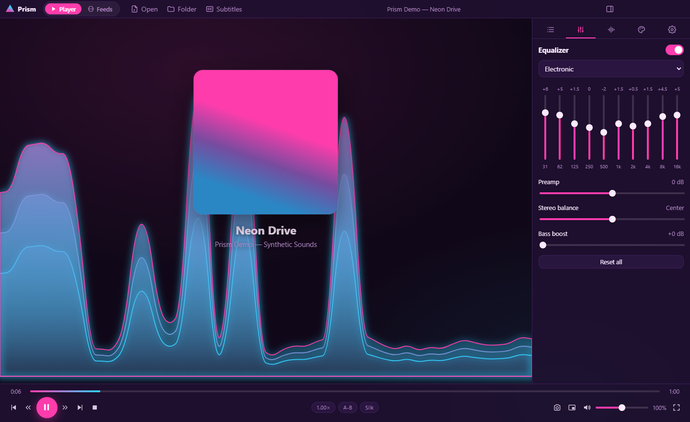
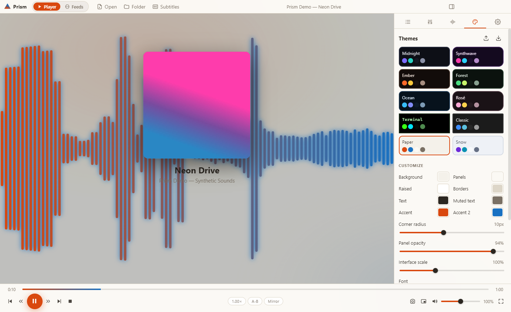
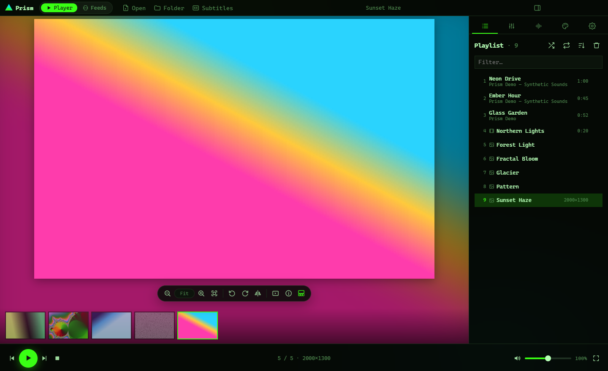
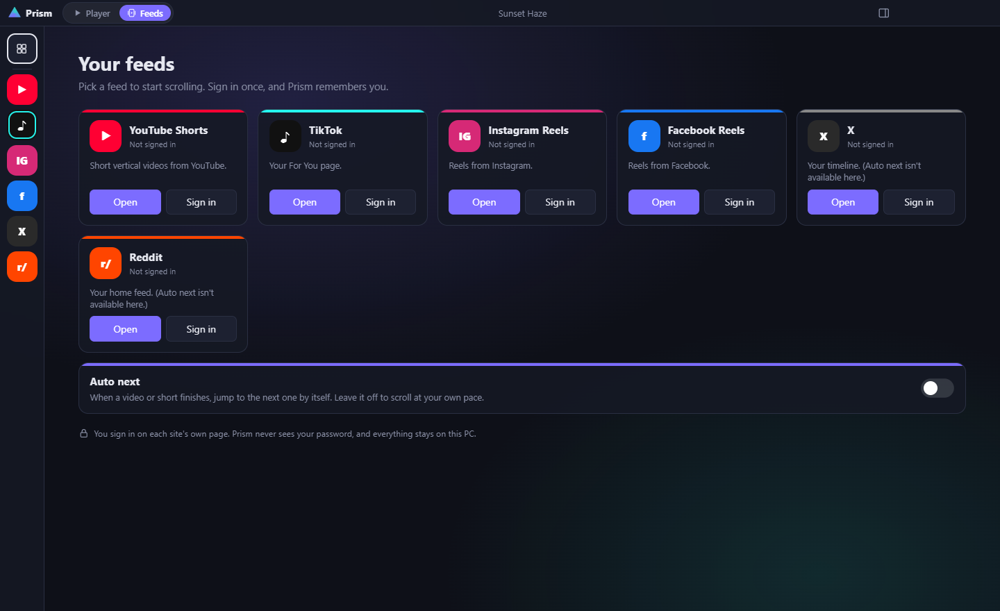

<div align="center">

# JS Player

**A media player, image viewer and feed scroller that plays almost anything and looks the way you want.**

Live audio visualizers · Full theme editor · 10-band equalizer · ffmpeg conversion for formats it can't open itself · Social feeds with optional auto next

[**⬇ Download for Windows**](https://github.com/JessniX/JS-Player/releases/latest) · [What's new](https://github.com/JessniX/JS-Player/releases)


</div>

---

## Contents

- [Features](#features)
- [Screenshots](#screenshots)
- [Getting started](#getting-started)
- [Keyboard shortcuts](#keyboard-shortcuts)
- [Supported formats](#supported-formats)
- [Feeds and privacy](#feeds-and-privacy)
- [Customizing and extending](#customizing-and-extending)
- [Project structure](#project-structure)
- [Development](#development)
- [License](#license)

---

## Features

### 🎵 Plays almost anything
- Video and audio play directly where possible: MP4, MKV, WebM, MP3, FLAC, WAV, OGG, Opus, AAC and more.
- Anything else (AVI, WMV, FLV, MPEG-2, HEVC without hardware support, WMA, APE, AC3, DTS…) is **converted once with ffmpeg and cached**, so it opens instantly next time. A progress bar shows while it converts.
- When only the audio is unsupported, the video is copied as-is, so conversion takes seconds.

### 🌈 Live visualizers
Seven modes that react to the music: **Bars**, **Mirror**, **Silk**, **Scope**, **Halo** (a ring around the album art), **Nebula** (particles that burst on the bass) and **Waterfall** (a scrolling spectrogram).
You can pick colors (your theme's, rainbow, fire, ice or your own 3-color gradient) and set the bar count, sensitivity, smoothing, glow and peak caps. The background can pulse with the bass, and the visualizer can play over videos.

### 🎨 Make it yours
- **12 built-in themes**, from the default Violet and the neutral Studio to Midnight, Synthwave and light Paper and Snow.
- **Reacts to the music:** while a track plays, the stage takes on a tint from the album art and the play button and progress bar pulse with the bass. A slow wave drifts across the empty screen. All of it turns off when Windows is set to reduce motion.
- **Live theme editor:** every color, corner roundness, panel transparency, interface size, font, and a background image with blur.
- **Custom CSS** box for anything else.
- Save your own themes and **share them** as `.json` files.

### 🎚️ Sound
- 10-band equalizer with 12 presets, plus preamp, bass boost and stereo balance.
- Volume up to **200%**.

### ▶️ Playback
- Playlist with drag-to-reorder, filter, shuffle and repeat (all or one).
- **Remembers where you stopped** in every file.
- A-B looping, speed from 0.25× to 4× (pitch stays the same), frame-by-frame stepping.
- Screenshots, picture-in-picture, fullscreen with auto-hiding controls, always on top, media-key support.
- **Subtitles** (`.srt` / `.vtt`) load automatically when they sit next to the video. Size and colors are adjustable.
- **Subtitle quick controls:** **G / H** move subtitles 0.1 s earlier or later (Shift: 1 s), **C** turns them on or off, **Shift+C** switches to the next one, **Alt + / −** changes the size. The same controls sit at the bottom of the **Subtitles** menu. For Discover shows, your subtitle choice and timing are remembered and come back on the next episode.
- **🌙 Sleep timer** (moon button or **Z**): stop after 15–90 minutes or at the end of this video. The sound fades out over the last 30 seconds, and a stream is closed properly so nothing keeps downloading.
- Press **?** (or F1) for a list of every keyboard shortcut.

### 📺 TV mode
- One click on **TV** in the title bar (or **Settings → Window**) turns JS Player into a big-screen app: everything 1.5× larger, full screen, with **Discover** as the home screen.
- No mouse needed: **arrow keys** (and TV remotes) move a large highlight, **Enter** chooses, **Back/Esc/Backspace** goes back. While watching, ← → seek, ↑ ↓ change volume and Enter plays/pauses.
- **Gamepads** work too: D-pad or left stick to move, **A** choose, **B** back, **Start** play/pause, **LB/RB** skip 10 seconds.
- JS Player remembers it, so it starts in TV mode next time.

### 🖼️ Image viewer
- Opens JPEG, PNG, animated GIF, WebP, AVIF, BMP, SVG and ICO directly. TIFF, HEIC, PSD, TGA, DDS, EXR, JPEG 2000 and JPEG XL are converted with ffmpeg.
- Open one photo and the rest of its folder comes along.
- Zoom toward the cursor, drag to pan, fit or 100%, rotate, flip.
- **Slideshow** with fade, zoom or slide transitions, a **filmstrip** of thumbnails, an info panel, and a choice of background (theme, black, checkerboard for transparency, or a blurred copy of the photo).

### 📱 Feeds
- Scroll **YouTube Shorts, TikTok, Instagram Reels, Facebook Reels, X and Reddit** without leaving the app.
- Sign in once on each site's own page and JS Player remembers you.
- **Auto next** (your choice, off by default) jumps to the next video when one finishes.
- Runs on the same engine as Chrome (Chromium 156), so feeds load as fast as in Chrome. **YouTube quality** can be Auto (like Chrome), Prefer HD (true 1080p) or Data saver, and a **full-screen** button gives the video the whole window.
- **Add any website** as a feed, with your own icon: fetch the site's icon, choose an image (PNG, JPG, SVG, ICO…) or type an emoji, and pick a color. Hide the feeds you don't use and put the rest in any order. Use **Customize** on the Feeds screen or **Settings → Feeds**.
- See [Feeds and privacy](#feeds-and-privacy).

### 🍿 Discover (Stremio add-ons)
- Works with **Stremio add-ons**: install one by pasting its link (`https://…/manifest.json` or `stremio://…`), then turn it on or off, reorder it, configure it or remove it in **Add-ons**.
- **The home page** opens with a rotating spotlight banner (title logo, rating, **Watch now**), a greeting, **🎲 Surprise me** for a random pick, genre chips, and rows such as **🔥 Popular right now** with rating and year on each poster.
- Browse each add-on's catalogs as rows of posters, open **See all** for a full grid, and **search** across every add-on that supports it.
- While a stream loads, the screen shows the movie's own logo over its blurred backdrop (and the episode for series), with **Cancel** always available. If it pauses to buffer later, the logo shows over the dimmed video.
- Details pages show the backdrop, rating, genres and description, plus **seasons and episodes** for series.
- **Streams** from all your add-ons are listed together and play right inside JS Player, with the visualizer and equalizer. YouTube and outside links open in your browser.
- **A stream list that's easy to pick from:** each stream shows badges for quality (4K, 1080p, 720p, CAM), HDR or Dolby Vision, size and how many people share it. Sort by **Best**, **Smallest** or **Most shared**, filter by quality, or group by add-on. **▶ Play best** picks for you, going for the quality you usually choose.
- **Up next for series:** near the end of an episode, a card with a 10-second countdown lines up the next one from the same add-on, in the same release and quality when the add-on marks it. **Play now** starts it at once; **Cancel** or **Esc** stops it. Turn it off in Settings → Discover.
- **Torrent streams play inside JS Player.** The video streams while it downloads, and a chip shows peers and speed. **Settings → Discover → Torrent streams** picks the engine:
  - **Automatic** (default): if the Stremio app is installed, JS Player quietly starts Stremio's own streaming engine in the background (no need to open Stremio). When you leave a stream, its torrent is removed from the engine so it stops downloading and sharing. When you close JS Player, the engine and everything it started are shut down, and if JS Player ever crashes, the leftover engine is cleaned up the next time it opens. A Stremio app you started yourself is never touched. In a side-by-side test on the same torrent it started about 3× sooner and downloaded about 1.7× faster than the built-in engine. Without Stremio, the built-in engine is used.
  - **Built-in** (WebTorrent): works on every PC with nothing else installed. Downloaded data is deleted when you move on unless you choose to keep it, and you can limit upload speed.
  - Stremio's engine isn't included in JS Player (it's Stremio's own software), so it's only used when Stremio is installed.
- Torrents share pieces with other people while you watch, so your IP address is visible to them; JS Player tells you this before the first one. If a torrent won't start, **Cancel**, **Esc** or **Stop** take you back to Discover, and after 45 seconds with nobody sharing it, JS Player gives up and says why.
- **Plays formats browsers can't:** when a stream has AC3, E-AC3, DTS or TrueHD audio, an AVI container, or video your PC can't decode, it's converted live with ffmpeg while you watch. Video the player understands is copied untouched, so it stays light on CPU, and seeking still works.
- **Sync with your Stremio account** (Settings → Discover): use your Stremio add-ons (changes sync both ways), see **Continue watching** and **Your library**, resume where you stopped, and save your watch progress back to Stremio. Your password goes only to Stremio and isn't saved; JS Player keeps an encrypted sign-in key on this PC.
- **Subtitles load automatically in your chosen language.** Subtitles that come with the torrent (`.srt`, `.vtt`, `.ass` files) or are built into the video come first, because they're timed for that exact release. Subtitle add-ons fill in when the torrent has none. The **Subtitles** button lists "From this video" and "From add-ons" separately.
- Starts with Stremio's official **Cinemeta** (catalogs and details) and **OpenSubtitles** add-ons. JS Player comes with no streams of its own; what you can watch depends on the add-ons you install, so use ones that are legal where you live.

---

## Screenshots

| | |
|:---:|:---:|
|  |  |
| **Welcome screen.** Drop files or folders anywhere. | **Bars visualizer** with album art and the playlist. |
|  |  |
| **Equalizer** with the Silk visualizer in the Synthwave theme. | **Theme editor** in the light Paper theme. |
|  |  |
| **Video** with subtitles loaded automatically. | **Image viewer** with filmstrip, in the Terminal theme. |
|  |  |
| **Feeds.** Pick a site, sign in, scroll. | **Settings** for playback, images, window and subtitles. |

---

## Getting started

### Install (easiest)
Download **`JS-Player-Setup-x.y.z.exe`** from the [latest release](https://github.com/JessniX/JS-Player/releases/latest) and run it. ffmpeg is included.
If Windows shows "Windows protected your PC" (the installer isn't code-signed yet), click **More info → Run anyway**.

**Automatic updates** (from 1.0.1 on): JS Player checks for new versions when it starts and every few hours, downloads them in the background and asks you to restart. If you choose Later, the update installs when you close the app. You can turn this off or check manually in **Settings → Updates**. Version 1.0.0 doesn't have the updater, so install 1.0.1 once by hand.

### Run from source

#### Requirements
- **Windows 10 or 11**. macOS and Linux should work too, but haven't been tested.
- **[Node.js](https://nodejs.org) 18 or newer**
- **ffmpeg** (optional, needed only for formats that don't open directly). `npm install` tries to download one automatically. If that fails, install it yourself:
  ```bash
  winget install ffmpeg
  ```

#### Install and run
```bash
git clone https://github.com/JessniX/JS-Player.git
```
```bash
cd JS-Player
```
```bash
npm install
```
```bash
npm start
```

On Windows you can also just double-click **`Start JS Player.bat`**. It installs everything the first time.

#### Build an installer
```bash
npm run dist
```
This makes a Windows installer in `dist/` that associates video, audio and image files with JS Player.

---

## Keyboard shortcuts

<details open>
<summary><b>Player</b></summary>

| Key | Action |
|---|---|
| `Space` / `K` | Play / pause |
| `←` / `→` | Seek (`Shift` = 1s, `Ctrl` = 60s) |
| `↑` / `↓` | Volume |
| `M` | Mute |
| `F` / `Enter` / double-click | Fullscreen |
| `Esc` | Leave fullscreen |
| `N` / `P` | Next / previous |
| `[` / `]` / `Backspace` | Slower / faster / normal speed |
| `,` / `.` | Frame step (while paused) |
| `L` | A-B loop |
| `V` | Next visualizer |
| `S` | Screenshot |
| `Tab` | Show / hide the side panel |
| `0`–`9` | Jump to 0–90% |
| `Ctrl+O` / `Ctrl+Shift+O` | Open files / open folder |

</details>

<details>
<summary><b>Image viewer</b></summary>

| Key | Action |
|---|---|
| `←` / `→` / `PgUp` / `PgDn` | Previous / next image |
| Mouse wheel, `+` / `−` | Zoom (`Shift`+wheel: next image) |
| Drag | Pan |
| `0` / `1` / double-click | Fit / 100% / toggle |
| `R` / `Shift+R` | Rotate right / left |
| `H` | Flip |
| `Space` | Slideshow |
| `I` / `T` | Info panel / filmstrip |
| `Home` / `End` | First / last image |

</details>

---

## Supported formats

| Type | Plays directly | Converted with ffmpeg (cached) |
|---|---|---|
| **Video** | MP4, M4V, MKV (H.264/VP9/AV1), WebM, OGV, MOV (H.264) | AVI, WMV, FLV, MPEG/VOB, TS/M2TS, 3GP, RM/RMVB, ASF, HEVC on PCs without hardware support, and more |
| **Audio** | MP3, FLAC, WAV, OGG, Opus, M4A/AAC | WMA, APE, WavPack, AC3, DTS, AIFF, ALAC, AMR, TTA, DSD (DSF/DFF), MKA |
| **Images** | JPEG, PNG, APNG, GIF, WebP, AVIF, BMP, SVG, ICO | TIFF, HEIC/HEIF*, PSD, TGA, DDS, EXR, HDR, JPEG 2000, JPEG XL, QOI, PCX, PNM |
| **Subtitles** | SRT, VTT | — |

\* HEIC support depends on your ffmpeg version.

Converted files are kept in the app's cache folder. Clear it from **Settings → Conversion cache**.

---

## Feeds and privacy

- **You sign in on each site's own page.** JS Player never sees, stores or sends your password.
- Sign-ins are kept in a **separate, saved browser session** used only by Feeds. To tell whether you're signed in, JS Player checks which login cookies exist; it never reads their values.
- **Sign out** on any card clears that site's cookies and storage from JS Player.
- Feed pages run in sandboxed views without access to your files or the rest of the app. Pop-ups (such as "Continue with Google") open in a small window in the same session.
- **Auto next is off by default.** JS Player asks the first time you open a video feed. When it's on and a video finishes, JS Player clicks the site's own "next" button if it has one, otherwise presses `↓`, otherwise scrolls down one screen. It works on YouTube Shorts, TikTok, Instagram and Facebook.
- When you leave a feed, its videos are paused and muted.

> **Note:** Google sometimes blocks sign-in from embedded browsers ("This browser or app may not be secure"). JS Player identifies itself like a normal browser to reduce this, but it can't be guaranteed. JS Player isn't affiliated with any of these platforms; their names belong to their owners, and using them is subject to each site's terms.

---

## Customizing and extending

| I want to… | Where |
|---|---|
| Add a visualizer | `src/visualizer.js`: write a `draw_<id>()` method and add it to `VIZ_MODES` |
| Add a built-in theme | `src/themes.js`: add an entry to `PRESET_THEMES` |
| Add an EQ preset | `src/app.js`: `EQ_PRESETS` |
| Add a feed site | In the app: **Customize** on the Feeds screen. To make it built in: add it to `BUILTIN_FEEDS` in `src/feeds.js` (and its login cookie in `feeds-main.js`) |
| Add default Stremio add-ons | `src/discover.js`: `DEFAULT_ADDONS` |
| Restyle anything | Theme editor → **Custom CSS**, or `src/styles.css` (everything uses CSS variables) |

Settings are saved in `%APPDATA%\JS Player\settings.json`.

---

## Project structure

```
JS-Player/
├── main.js            # Window, prism:// protocol (UI + streaming), ffmpeg probe/convert, settings
├── feeds-main.js      # Feeds session, locked-down webviews, sign-in status, sign out
├── updater-main.js    # Auto-update from GitHub releases
├── stremio-main.js    # Stremio add-on requests, account sync and the stream relay
├── torrent-main.js    # Built-in torrent streaming (WebTorrent)
├── live-main.js       # Live conversion of streams with ffmpeg
├── preload.js         # Safe bridge between the app window and the main process
├── src/
│   ├── index.html     # Layout
│   ├── styles.css     # All styling (theme variables)
│   ├── astryx-tokens.css # Spacing, type and motion tokens (from Astryx)
│   ├── app.js         # Player, playlist, equalizer, settings, theme editor
│   ├── visualizer.js  # Visualizer modes
│   ├── imageviewer.js # Image viewer, slideshow, filmstrip
│   ├── feeds.js       # Feeds screen and auto next
│   ├── feeds-custom.js # Customize Feeds: your own sites and icons
│   ├── discover.js    # Discover: Stremio add-ons, catalogs, details, streams, subtitles
│   ├── upnext.js      # Up next: lines up and plays the next episode
│   ├── sleep.js       # Sleep timer and the keyboard shortcuts overlay
│   ├── stremio-sync.js # Stremio account: add-ons, library, Continue Watching, progress
│   ├── brand-icons.js # Feeds logos (Simple Icons)
│   ├── ambience.js    # Album-art tint, bass pulse, idle wave
│   ├── updates.js     # Settings → Updates and the update-ready notice
│   ├── themes.js      # Built-in themes
│   └── icons.js       # Icon set
├── docs/screenshots/  # Images used in this README
└── Start JS Player.bat    # Double-click launcher for Windows
```

Built with [Electron](https://www.electronjs.org/), the Web Audio API and [ffmpeg](https://ffmpeg.org/).

---

## Development

`npm run smoke` runs the app in a self-test mode that loads, runs scripted steps and saves screenshots, then quits. Useful environment variables:

| Variable | Purpose |
|---|---|
| `PRISM_SMOKE_STEPS` | JavaScript steps to run in the window, separated by `\|\|\|` |
| `PRISM_SMOKE_DIR` | Where screenshots are saved |
| `PRISM_SMOKE_SIZE` | Window size, such as `1440x880` |
| `PRISM_SMOKE_SILENT` | Mute audio during the run |
| `PRISM_SMOKE_SHOW` | Show the window (needed for Feeds to load at full speed) |
| `PRISM_DEBUG` | Path of a log file for startup diagnostics |
| `PRISM_UPDATE_URL` | Test auto-update against a local folder or server (with `latest.yml`) instead of GitHub; never installs |
| `PRISM_SMOKE_STEPS_FILE` | Read the steps from a file instead of `PRISM_SMOKE_STEPS` |

The screenshots in this README were made this way, using generated demo media.

---

## Credits

- Violet and Studio themes, music-reactive visuals, Feeds logos and accessibility improvements contributed by [multiplayereverything](https://github.com/multiplayereverything) in [#1](https://github.com/JessniX/JS-Player/pull/1).
- Spacing, type, radius, shadow and motion tokens from [Astryx](https://github.com/meta/astryx) (MIT), copied into `src/astryx-tokens.css`.
- Feeds logos from [Simple Icons](https://simpleicons.org) (CC0). The logos are trademarks of their owners and only label links to their sites.

## License

[MIT](LICENSE)
