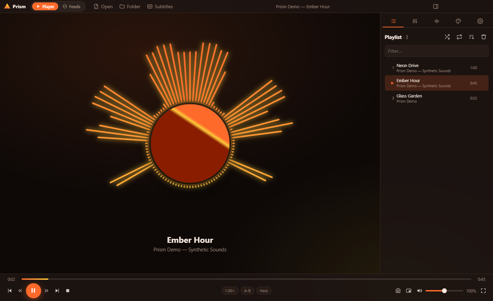
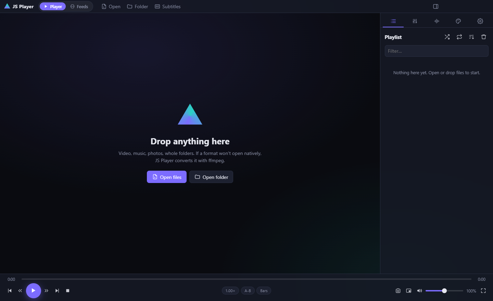
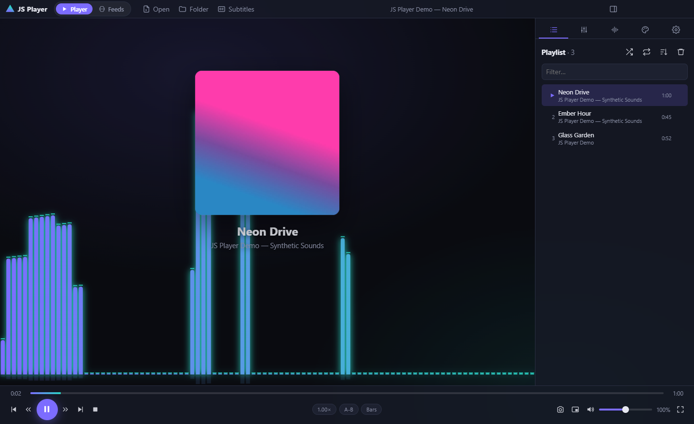
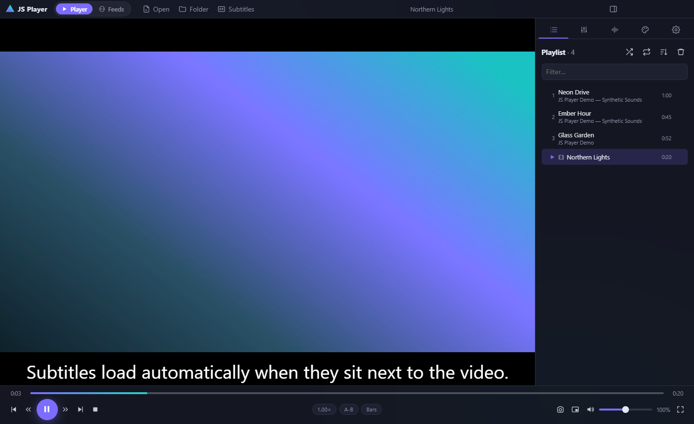
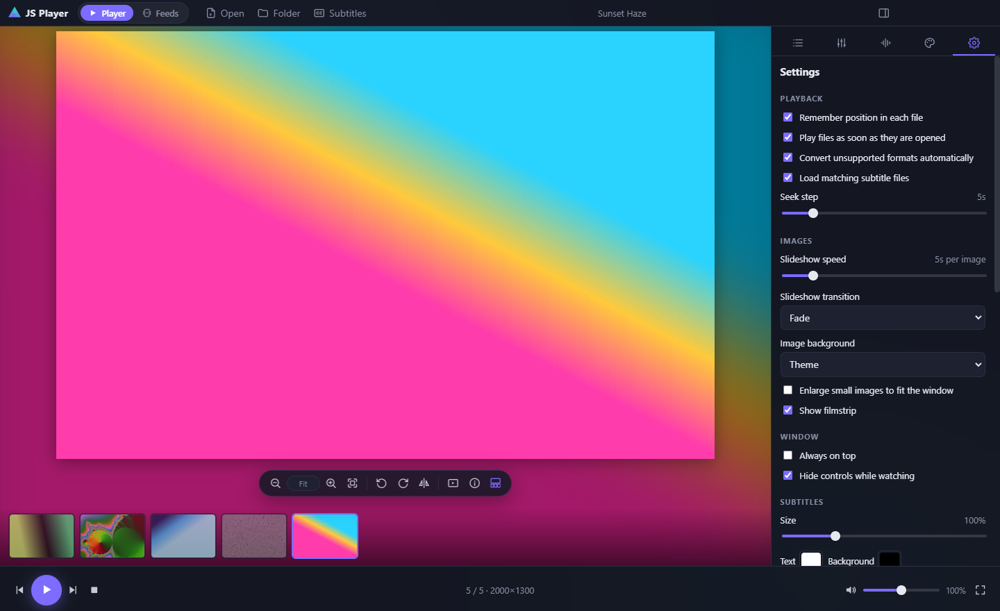

<div align="center">

# JS Player

**A media player, image viewer and feed scroller that plays almost anything and looks the way you want.**

Live audio visualizers · Full theme editor · 10-band equalizer · ffmpeg conversion for formats it can't open itself · Social feeds with optional auto next

[**⬇ Download for Windows**](https://github.com/JessniX/JS-Player/releases/latest) · [What's new](https://github.com/JessniX/JS-Player/releases)



</div>

---

## Contents

- [Features](#features)
- [Screenshots](#screenshots)
- [Getting started](#getting-started)
- [Keyboard shortcuts](#keyboard-shortcuts)
- [Supported formats](#supported-formats)
- [Feeds and privacy](#feeds-and-privacy)
- [Customizing and extending](#customizing-and-extending)
- [Project structure](#project-structure)
- [Development](#development)
- [License](#license)

---

## Features

### 🎵 Plays almost anything
- Video and audio play directly where possible: MP4, MKV, WebM, MP3, FLAC, WAV, OGG, Opus, AAC and more.
- Anything else (AVI, WMV, FLV, MPEG-2, HEVC without hardware support, WMA, APE, AC3, DTS…) is **converted once with ffmpeg and cached**, so it opens instantly next time. A progress bar shows while it converts.
- When only the audio is unsupported, the video is copied as-is, so conversion takes seconds.

### 🌈 Live visualizers
Seven modes that react to the music: **Bars**, **Mirror**, **Silk**, **Scope**, **Halo** (a ring around the album art), **Nebula** (particles that burst on the bass) and **Waterfall** (a scrolling spectrogram).
You can pick colors (your theme's, rainbow, fire, ice or your own 3-color gradient) and set the bar count, sensitivity, smoothing, glow and peak caps. The background can pulse with the bass, and the visualizer can play over videos.

### 🎨 Make it yours
- **10 built-in themes**, from dark Midnight and Synthwave to light Paper and Snow.
- **Live theme editor:** every color, corner roundness, panel transparency, interface size, font, and a background image with blur.
- **Custom CSS** box for anything else.
- Save your own themes and **share them** as `.json` files.

### 🎚️ Sound
- 10-band equalizer with 12 presets, plus preamp, bass boost and stereo balance.
- Volume up to **200%**.

### ▶️ Playback
- Playlist with drag-to-reorder, filter, shuffle and repeat (all or one).
- **Remembers where you stopped** in every file.
- A-B looping, speed from 0.25× to 4× (pitch stays the same), frame-by-frame stepping.
- Screenshots, picture-in-picture, fullscreen with auto-hiding controls, always on top, media-key support.
- **Subtitles** (`.srt` / `.vtt`) load automatically when they sit next to the video. Size and colors are adjustable.

### 🖼️ Image viewer
- Opens JPEG, PNG, animated GIF, WebP, AVIF, BMP, SVG and ICO directly. TIFF, HEIC, PSD, TGA, DDS, EXR, JPEG 2000 and JPEG XL are converted with ffmpeg.
- Open one photo and the rest of its folder comes along.
- Zoom toward the cursor, drag to pan, fit or 100%, rotate, flip.
- **Slideshow** with fade, zoom or slide transitions, a **filmstrip** of thumbnails, an info panel, and a choice of background (theme, black, checkerboard for transparency, or a blurred copy of the photo).

### 📱 Feeds
- Scroll **YouTube Shorts, TikTok, Instagram Reels, Facebook Reels, X and Reddit** without leaving the app.
- Sign in once on each site's own page and JS Player remembers you.
- **Auto next** (your choice, off by default) jumps to the next video when one finishes.
- See [Feeds and privacy](#feeds-and-privacy).

---

## Screenshots

| | |
|:---:|:---:|
|  |  |
| **Welcome screen.** Drop files or folders anywhere. | **Bars visualizer** with album art and the playlist. |
|  |  |
| **Equalizer** with the Silk visualizer in the Synthwave theme. | **Theme editor** in the light Paper theme. |
|  |  |
| **Video** with subtitles loaded automatically. | **Image viewer** with filmstrip, in the Terminal theme. |
|  |  |
| **Feeds.** Pick a site, sign in, scroll. | **Settings** for playback, images, window and subtitles. |

---

## Getting started

### Install (easiest)
Download **`JS-Player-Setup-x.y.z.exe`** from the [latest release](https://github.com/JessniX/JS-Player/releases/latest) and run it. ffmpeg is included.
If Windows shows "Windows protected your PC" (the installer isn't code-signed yet), click **More info → Run anyway**.

### Run from source

#### Requirements
- **Windows 10 or 11**. macOS and Linux should work too, but haven't been tested.
- **[Node.js](https://nodejs.org) 18 or newer**
- **ffmpeg** (optional, needed only for formats that don't open directly). `npm install` tries to download one automatically. If that fails, install it yourself:
  ```bash
  winget install ffmpeg
  ```

#### Install and run
```bash
git clone https://github.com/JessniX/JS-Player.git
```
```bash
cd JS-Player
```
```bash
npm install
```
```bash
npm start
```

On Windows you can also just double-click **`Start JS Player.bat`**. It installs everything the first time.

#### Build an installer
```bash
npm run dist
```
This makes a Windows installer in `dist/` that associates video, audio and image files with JS Player.

---

## Keyboard shortcuts

<details open>
<summary><b>Player</b></summary>

| Key | Action |
|---|---|
| `Space` / `K` | Play / pause |
| `←` / `→` | Seek (`Shift` = 1s, `Ctrl` = 60s) |
| `↑` / `↓` | Volume |
| `M` | Mute |
| `F` / `Enter` / double-click | Fullscreen |
| `Esc` | Leave fullscreen |
| `N` / `P` | Next / previous |
| `[` / `]` / `Backspace` | Slower / faster / normal speed |
| `,` / `.` | Frame step (while paused) |
| `L` | A-B loop |
| `V` | Next visualizer |
| `S` | Screenshot |
| `Tab` | Show / hide the side panel |
| `0`–`9` | Jump to 0–90% |
| `Ctrl+O` / `Ctrl+Shift+O` | Open files / open folder |

</details>

<details>
<summary><b>Image viewer</b></summary>

| Key | Action |
|---|---|
| `←` / `→` / `PgUp` / `PgDn` | Previous / next image |
| Mouse wheel, `+` / `−` | Zoom (`Shift`+wheel: next image) |
| Drag | Pan |
| `0` / `1` / double-click | Fit / 100% / toggle |
| `R` / `Shift+R` | Rotate right / left |
| `H` | Flip |
| `Space` | Slideshow |
| `I` / `T` | Info panel / filmstrip |
| `Home` / `End` | First / last image |

</details>

---

## Supported formats

| Type | Plays directly | Converted with ffmpeg (cached) |
|---|---|---|
| **Video** | MP4, M4V, MKV (H.264/VP9/AV1), WebM, OGV, MOV (H.264) | AVI, WMV, FLV, MPEG/VOB, TS/M2TS, 3GP, RM/RMVB, ASF, HEVC on PCs without hardware support, and more |
| **Audio** | MP3, FLAC, WAV, OGG, Opus, M4A/AAC | WMA, APE, WavPack, AC3, DTS, AIFF, ALAC, AMR, TTA, DSD (DSF/DFF), MKA |
| **Images** | JPEG, PNG, APNG, GIF, WebP, AVIF, BMP, SVG, ICO | TIFF, HEIC/HEIF*, PSD, TGA, DDS, EXR, HDR, JPEG 2000, JPEG XL, QOI, PCX, PNM |
| **Subtitles** | SRT, VTT | — |

\* HEIC support depends on your ffmpeg version.

Converted files are kept in the app's cache folder. Clear it from **Settings → Conversion cache**.

---

## Feeds and privacy

- **You sign in on each site's own page.** JS Player never sees, stores or sends your password.
- Sign-ins are kept in a **separate, saved browser session** used only by Feeds. To tell whether you're signed in, JS Player checks which login cookies exist; it never reads their values.
- **Sign out** on any card clears that site's cookies and storage from JS Player.
- Feed pages run in sandboxed views without access to your files or the rest of the app. Pop-ups (such as "Continue with Google") open in a small window in the same session.
- **Auto next is off by default.** JS Player asks the first time you open a video feed. When it's on and a video finishes, JS Player clicks the site's own "next" button if it has one, otherwise presses `↓`, otherwise scrolls down one screen. It works on YouTube Shorts, TikTok, Instagram and Facebook.
- When you leave a feed, its videos are paused and muted.

> **Note:** Google sometimes blocks sign-in from embedded browsers ("This browser or app may not be secure"). JS Player identifies itself like a normal browser to reduce this, but it can't be guaranteed. JS Player isn't affiliated with any of these platforms; their names belong to their owners, and using them is subject to each site's terms.

---

## Customizing and extending

| I want to… | Where |
|---|---|
| Add a visualizer | `src/visualizer.js`: write a `draw_<id>()` method and add it to `VIZ_MODES` |
| Add a built-in theme | `src/themes.js`: add an entry to `PRESET_THEMES` |
| Add an EQ preset | `src/app.js`: `EQ_PRESETS` |
| Add a feed site | `src/feeds.js`: add an entry to `FEEDS` (and its login cookie in `feeds-main.js`) |
| Restyle anything | Theme editor → **Custom CSS**, or `src/styles.css` (everything uses CSS variables) |

Settings are saved in `%APPDATA%\JS Player\settings.json`.

---

## Project structure

```
JS-Player/
├── main.js            # Window, prism:// protocol (UI + streaming), ffmpeg probe/convert, settings
├── feeds-main.js      # Feeds session, locked-down webviews, sign-in status, sign out
├── preload.js         # Safe bridge between the app window and the main process
├── src/
│   ├── index.html     # Layout
│   ├── styles.css     # All styling (theme variables)
│   ├── app.js         # Player, playlist, equalizer, settings, theme editor
│   ├── visualizer.js  # Visualizer modes
│   ├── imageviewer.js # Image viewer, slideshow, filmstrip
│   ├── feeds.js       # Feeds screen and auto next
│   ├── themes.js      # Built-in themes
│   └── icons.js       # Icon set
├── docs/screenshots/  # Images used in this README
└── Start JS Player.bat    # Double-click launcher for Windows
```

Built with [Electron](https://www.electronjs.org/), the Web Audio API and [ffmpeg](https://ffmpeg.org/).

---

## Development

`npm run smoke` runs the app in a self-test mode that loads, runs scripted steps and saves screenshots, then quits. Useful environment variables:

| Variable | Purpose |
|---|---|
| `PRISM_SMOKE_STEPS` | JavaScript steps to run in the window, separated by `\|\|\|` |
| `PRISM_SMOKE_DIR` | Where screenshots are saved |
| `PRISM_SMOKE_SIZE` | Window size, such as `1440x880` |
| `PRISM_SMOKE_SILENT` | Mute audio during the run |
| `PRISM_SMOKE_SHOW` | Show the window (needed for Feeds to load at full speed) |
| `PRISM_DEBUG` | Path of a log file for startup diagnostics |

The screenshots in this README were made this way, using generated demo media.

---

## License

[MIT](LICENSE)
